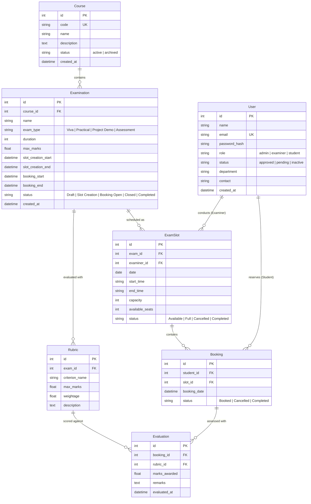

# IIT Madras — Diploma in Programming & Data Science
## Course: Modern Application Development 1 (MAD-1)
### Final Project Report: Examination Management Portal (EMP)

---

## 1. Student Details

| Field | Information |
| :--- | :--- |
| **Student Name** | Nandeesh Kantli |
| **Roll Number** | 24F1002499 |
| **Program** | Diploma in Programming / Data Science & Applications |
| **Term** | September 2026 (T3 2026) |
| **Submission Deadline** | November 17, 2026 |
| **Repository URL** | [https://github.com/tan1ro/trekking-management-app](https://github.com/tan1ro/trekking-management-app) |
| **Presentation Video Link** | [Google Drive Video Link Placeholder - Public Access](https://drive.google.com/) |

---

## 2. Project Overview & Problem Statement

### 2.1 Problem Statement
Educational institutions often struggle with coordinating examinations (such as vivas, project demonstrations, and practical assessments) due to reliance on manual spreadsheets, emails, and fragmented schedules. This leads to scheduling conflicts, lack of visibility into examiner availability, difficulties in slot booking, and unstandardized student evaluation.

The goal of this project is to build an **Examination Management Portal (EMP)** web application that enables **Administrators**, **Examiners**, and **Students** to interact seamlessly with dedicated role-based access, strict schedule and capacity constraints, and rubric-based evaluations.

### 2.2 Solution Approach
The application was designed using the **Model-View-Controller (MVC)** architectural pattern:
1. **Model Layer (`models.py`):** Relational schema implemented using Flask-SQLAlchemy over an SQLite database. It establishes 7 core entities (`User`, `Course`, `Examination`, `Rubric`, `ExamSlot`, `Booking`, `Evaluation`) with appropriate foreign key relationships, cascade rules, and validation helper methods.
2. **Controller Layer (`app.py`):** Flask application handling authentication, role-based route protection, business logic constraints (such as slot availability, duplicate booking guards, and evaluation permissions), and flash messaging.
3. **View Layer (`templates/`):** Clean, standard server-rendered Jinja2 HTML templates styled with **Bootstrap 5**, ensuring responsiveness without relying on client-side JavaScript for core application requirements.
4. **Programmatic Initialization (`create_db.py`):** Automatically drops, creates, and seeds the SQLite database with realistic mock data across all roles, ready for immediate local execution and evaluation.

---

## 3. AI / LLM Declaration

*In accordance with the IIT Madras MAD-1 Project Guidelines on AI/LLM Usage:*

| Category | Declaration Details |
| :--- | :--- |
| **Extent of AI Assistance** | AI coding assistance was utilized for scaffolding boilerplate templates, structuring SQLite models, and drafting documentation. |
| **Code Understanding** | The entire business logic, route controllers, session handling, relational constraints, and database queries have been reviewed, verified, and executed locally by the student. |
| **Viva Readiness** | The student possesses complete understanding of every file, function, and database table, and is fully prepared to explain, modify, and live-code logic during Level 1 and Level 2 vivas. |

---

## 4. Frameworks & Libraries Used

* **Back-end Web Framework:** **Flask** (v2.3+)
* **Database & ORM:** **SQLite** (standard lightweight relational database) with **Flask-SQLAlchemy** (v3.0+)
* **Authentication & Security:** **Werkzeug Security** (`generate_password_hash`, `check_password_hash`) and Flask Session
* **Front-end Templating:** **Jinja2**
* **Styling & Layout:** **Bootstrap 5** (CSS CDN) & HTML5
* **Programming Language:** **Python 3.10+**

> **Note on Core Requirements:** In accordance with IITM guidelines, no client-side JavaScript was used to execute any core business logic, validation, or database modifications.

---

## 5. Database Architecture & Entity-Relationship Diagram

### 5.1 ER Diagram

### 5.2 Key Relational Constraints & Data Integrity
1. **User Role Separation:** Admin is strictly pre-seeded. Examiners register with `pending` status. Students register with `approved` status. Passwords are encrypted via PBKDF2/SHA-256.
2. **Inventory Management:** When a student books a slot, `available_seats` is decremented by 1. When `available_seats == 0`, slot status transitions to `Full`. When a booking is cancelled, `available_seats` is incremented by 1 and the slot is restored to `Available`.
3. **One Booking Per Exam:** The system queries existing bookings for a student across all slots of a particular examination to prevent duplicate bookings.
4. **Evaluation Ownership:** An examiner can only evaluate students who have active bookings in time slots assigned to that specific examiner.

---

## 6. Route Map & API Endpoints

| Category | Endpoint | HTTP Method | Functionality & Role Access |
| :--- | :--- | :--- | :--- |
| **Auth** | `/login` | GET, POST | Authenticates users; checks role and approval status |
| **Auth** | `/register` | GET, POST | Self-registration for Examiners (`pending`) and Students (`approved`) |
| **Auth** | `/logout` | GET | Clears session and redirects to login |
| **Auth** | `/profile` | GET, POST | Allows users to edit profile and update password |
| **Admin** | `/admin/dashboard` | GET | Metrics (Courses, Exams, Examiners, Students, Slots, Bookings) & search |
| **Admin** | `/admin/courses` | GET, POST | List all courses and create new course |
| **Admin** | `/admin/courses/<id>/edit` | GET, POST | Edit course code, name, and description |
| **Admin** | `/admin/courses/<id>/delete` | POST | Delete course and cascade examinations |
| **Admin** | `/admin/exams` | GET | Directory of all examinations with quick status switcher |
| **Admin** | `/admin/exams/create` | GET, POST | Create examination with timeline start/end dates |
| **Admin** | `/admin/exams/<id>/edit` | GET, POST | Edit examination parameters and timelines |
| **Admin** | `/admin/exams/<id>/status` | POST | Transition examination status (*Draft, Slot Creation, Booking Open, Closed, Completed*) |
| **Admin** | `/admin/exams/<id>/delete` | POST | Delete examination and related slots |
| **Admin** | `/admin/exams/<id>/rubrics` | GET, POST | Manage criteria, max marks, and weightages |
| **Admin** | `/admin/rubrics/<id>/delete` | POST | Remove specific rubric criterion |
| **Admin** | `/admin/examiners` | GET | View all examiners and their approval status |
| **Admin** | `/admin/examiners/<id>/approve`| POST | Approve pending examiner registration |
| **Admin** | `/admin/examiners/<id>/toggle` | POST | Deactivate or activate examiner account |
| **Admin** | `/admin/slots` | GET | Oversight of all scheduled slots |
| **Admin** | `/admin/slots/<id>/change_examiner` | POST | Reassign examiner to a slot in exceptional cases |
| **Admin** | `/admin/bookings` | GET | Complete roster of all student bookings |
| **Admin** | `/admin/bookings/<id>/reschedule` | GET, POST | Reschedule student booking to an alternative available slot |
| **Examiner**| `/examiner/dashboard` | GET | Overview of assigned slots, candidate counts, and pending evaluations |
| **Examiner**| `/examiner/slots/create` | GET, POST | Create new slot during active `Slot Creation` window |
| **Examiner**| `/examiner/slots/<id>/edit` | GET, POST | Edit slot parameters (allowed only with 0 bookings) |
| **Examiner**| `/examiner/slots/<id>/delete` | POST | Remove slot (allowed only with 0 bookings) |
| **Examiner**| `/examiner/slots/<id>/students`| GET | View candidate roster booked for the slot |
| **Examiner**| `/examiner/bookings/<id>/evaluate`| GET, POST| Grade candidate against rubrics and submit feedback |
| **Student** | `/student/dashboard` | GET | View upcoming bookings, available exams, and published results |
| **Student** | `/student/exams` | GET | Browse, search, and filter open examinations |
| **Student** | `/student/exams/<id>/slots` | GET | View available slots for an exam |
| **Student** | `/student/slots/<id>/book` | POST | Book slot (enforces open window, capacity, duplicate check) |
| **Student** | `/student/bookings/<id>/cancel`| POST | Cancel booking before deadline (restores slot seat) |
| **Student** | `/student/history` | GET | View complete historical booking log |
| **Student** | `/student/scorecard/<id>` | GET | View official rubric evaluation breakdown & remarks |

---

## 7. Role-Wise Workflow & Core Features

### 7.1 Administrator Workflow
1. Log in via `admin@emp.iitm.ac.in` / `Admin@123`.
2. Create courses (e.g., `CS2001 - Modern Application Development I`).
3. Create examinations under courses with start/end windows for slot creation and student booking.
4. Define evaluation rubrics with maximum marks and weightages.
5. Review pending examiner registration requests and approve them.
6. Oversee slots and bookings, with full capability to reschedule bookings or reassign examiners.

### 7.2 Examiner Workflow
1. Register with name, department, contact, and email. The account is set to `pending`.
2. Once approved by the administrator, log in to the **Examiner Portal**.
3. Create slots for exams currently in the `Slot Creation` status.
4. Slots with 0 bookings can be edited or deleted; once a student books, the slot is locked for modification.
5. On the exam date, open the slot roster and grade candidates rubric-by-rubric with specific criterion marks and remarks.
6. Submitting the evaluation transitions the booking status to `Completed` and publishes the score.

### 7.3 Student Workflow
1. Register as a student and log in directly to the **Student Portal**.
2. Search and filter active examinations by course or examination type.
3. Select an open examination to inspect available time slots and examiner assignments.
4. Book a preferred time slot; the system verifies availability and prevents duplicate booking for that examination.
5. Cancel a booking if needed prior to the deadline, which immediately releases the seat back to other students.
6. Once evaluated by the examiner, view the detailed **Official Scorecard** showing criterion-wise marks, percentage, and feedback.

---

## 8. Video Presentation & Demonstration Outline (5 - 10 Minutes)

* **0:00 - 0:30 (Introduction):** Student name, roll number, project title (*Examination Management Portal*), and overview.
* **0:30 - 1:00 (Problem & Approach):** Explaining the need for automated exam slotting, the 3-tier RBAC architecture, and relational SQLite design.
* **1:00 - 4:00 (Core Feature Demo):**
  * *Admin Demonstration:* Metrics, course creation, exam setup, rubric definition, examiner approval.
  * *Examiner Demonstration:* Slot creation during open window, slot locking, student roster view, rubric evaluation.
  * *Student Demonstration:* Exam filtering, slot booking, duplicate booking check, cancellation, and viewing the published scorecard.
* **4:00 - 5:00 (Key Constraints & Code Walkthrough):** Highlighting SQLAlchemy relationships, session security, password hashing, and answering common architectural questions.
