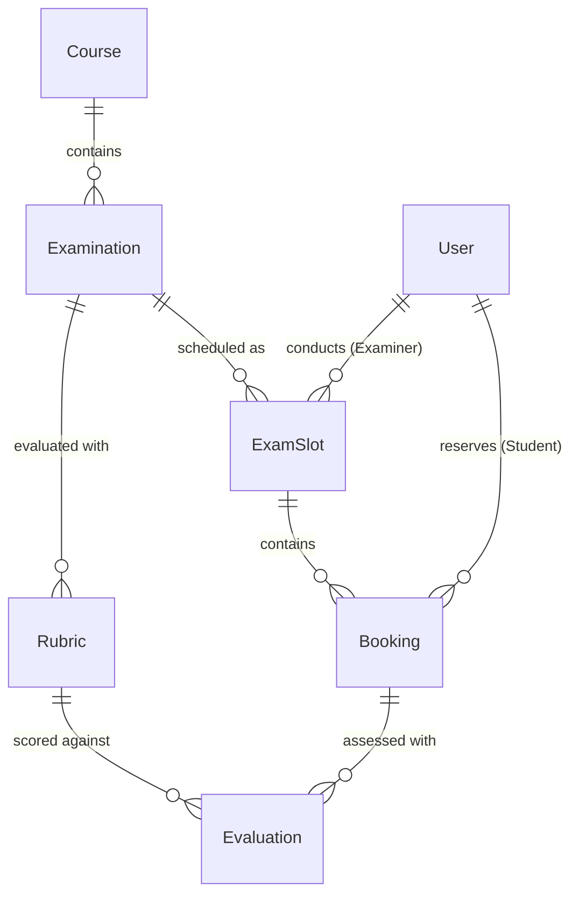

# Examination Management Portal (EMP)

A lightweight web application built for educational institutions to manage examination schedules, student slot booking, and rubric-based evaluations.

Developed for **IIT Madras Diploma in Programming & Data Science — Modern Application Development 1 (MAD-1)**.

---

## 🌟 Tech Stack

* **Backend:** Python + **Flask**
* **Database:** **SQLite** with **Flask-SQLAlchemy** (Created programmatically)
* **Frontend:** **Jinja2** HTML templates + **Bootstrap 5** (No client-side JS used for core requirements)
* **Security:** Role-based access control (Admin, Examiner, Student), hashed passwords with `werkzeug.security`

---

## 🚀 Quick Run (Under 1 Minute)

### 1. Initialize the Database
```bash
python3 create_db.py
```

### 2. Start the Server
```bash
python3 app.py
```
Open **[http://127.0.0.1:5001](http://127.0.0.1:5001)** in your browser.

---

## 🔑 Demo Login Accounts

| Role | Name | Email | Password | Viva Demo Scenario |
| :--- | :--- | :--- | :--- | :--- |
| **Admin** | System Admin | `admin@emp.iitm.ac.in` | `Admin@123` | Pre-existing superuser |
| **Examiner** | Dr. Ramesh Sharma | `dr.sharma@emp.iitm.ac.in` | `Examiner@123` | **Approved** &bull; Can create slots & evaluate students |
| **Examiner** | Prof. Ankit Verma | `prof.verma@emp.iitm.ac.in` | `Examiner@123` | **Pending** &bull; Tests Admin approval flow |
| **Student** | Nandeesh Kantli | `nandeesh@emp.iitm.ac.in` | `Student@123` | **Candidate** &bull; Ready to book open exam slots live |
| **Student** | Aarav Patel | `aarav.patel@emp.iitm.ac.in` | `Student@123` | **Evaluated** &bull; Has published scorecard (38/40 pts) |

*Full documentation of users and test scenarios is available in [USERS.md](USERS.md).*
*Official project report and ER diagram are available in [PROJECT_REPORT.md](PROJECT_REPORT.md).*

---

## 👥 Core Features by Role

### 1. Admin
* Dashboard with total counts for Courses, Exams, Examiners, Students, Slots, and Bookings.
* Manage courses (create, edit, delete).
* Manage examinations (create, edit, delete, status transitions).
* Define examination rubrics (criteria, max marks, weightage, description).
* Approve or deactivate examiners.
* Oversight of all slots and bookings (reschedule student bookings, reassign examiners).
* Search bar across students, examiners, examinations, and bookings.

### 2. Examiner
* Self-register (requires Admin approval to access dashboard).
* Create slots during open slot creation window.
* Edit/delete slots before any bookings occur.
* View candidate roster booked for each slot.
* Evaluate candidates using official examination rubrics (marks + remarks).

### 3. Student
* Self-register and log in directly.
* Search and filter examinations.
* Book available examination slots (enforces open booking window, capacity, 1 booking per exam).
* Cancel booking before deadline (restores slot seat).
* View complete history and detailed scorecards.

---

## 📊 Database Schema (7 Entities)



---

## 👤 Author
* **Name:** Nandeesh Kantli
* **Roll No:** 24F1002499
* **Course:** Modern Application Development 1 (MAD-1), IIT Madras
